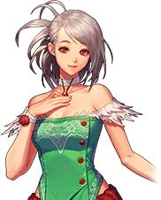
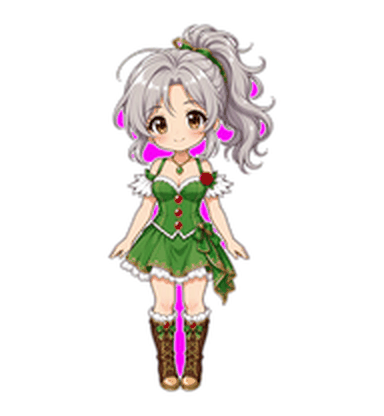
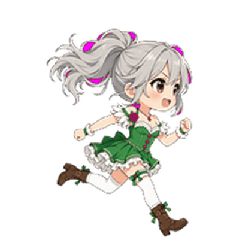
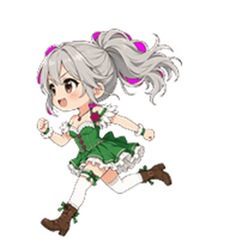
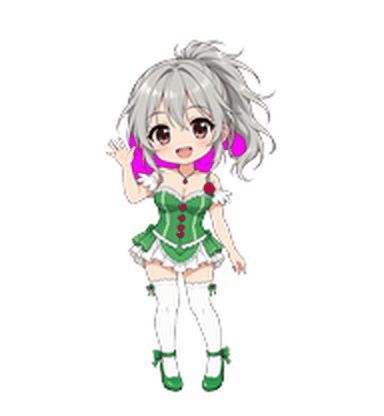
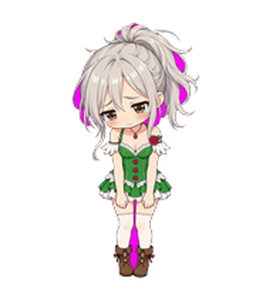
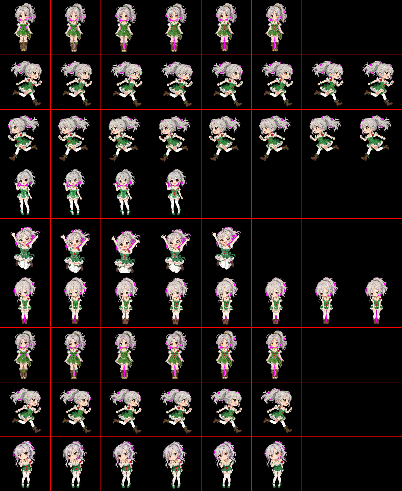

# silver-ponytail · 银马尾少女

一个 [Qoder](https://qoder.com) 桌面宠物包（Petdex 本地包）。角色为银灰色高马尾、
绿色束胸裙的二次元少女，六张姿势素材由 AI 生成，再程序化合成为符合 Qoder
加载器规范的 spritesheet。

<p>
  
  
</p>

## 安装

```bash
git clone https://github.com/dyrone/dyrone-petdex.git
mkdir -p ~/.petdex/pets
cp -r dyrone-petdex/silver-ponytail ~/.petdex/pets/
```

然后打开 Qoder 的桌宠设置，刷新已安装宠物并选择「银马尾少女」。
修改 spritesheet 后内容哈希会变化，Qoder 会自动重新编译外观缓存。

## 动画一览

各动画的触发时机由 Qoder 决定，这里展示 spritesheet 中每一行的实际效果。

| 动画 | 效果 | 说明 |
|---|---|---|
| idle |  | 静息，2px 单次呼吸 |
| running |  | 跑动，3px 步态弧线 |
| runningRight |  | 向右跑（前倾） |
| runningLeft |  | 向左跑（镜像） |
| waving |  | 挥手打招呼 |
| jumping |  | 跳跃，大幅平滑弧线 |
| failed |  | 失落低头 |
| waiting |  | 等待，缓慢侧倾 |
| review |  | 端详审视 |

GIF 中相邻完全相同的帧会被合并并累加延迟，播放节奏与 spritesheet 一致。

## 素材总览



8 列 × 9 行网格，单元格 192 × 208。红色网格线仅用于预览，不参与渲染。

## 包格式（spriteVersionNumber 1）

包目录固定为 `~/.petdex/pets/<slug>/`，包含两个文件：

```
silver-ponytail/
├── pet.json           # id 须与目录名一致
└── spritesheet.png    # 静态单页 PNG，8 列 × 9 行
```

`pet.json`：

```json
{
  "id": "silver-ponytail",
  "displayName": "银马尾少女",
  "spriteVersionNumber": 1
}
```

spritesheet 约束（源自 Qoder 加载器校验）：

- 总宽可被 8 整除，总高可被 9 整除
- 单元格宽高比恒为 12:13，且不小于 48 × 52（本包取 192 × 208）
- 单元格宽 × 13 === 单元格高 × 12
- 同目录有且仅有一个 `spritesheet.png`（或 `spritesheet.webp`）

每行的动画名、帧数与帧延迟（ms）由 Qoder 硬编码，**spritesheet 每行实际绘制的
帧数必须与之一致**，多出的格子留空会导致动画出现空白帧：

| 行 | 动画 | 帧数 | 帧延迟 (ms) |
|---|---|---|---|
| 0 | idle | 6 | 280, 110, 110, 140, 140, 320 |
| 1 | runningRight | 8 | 120 × 7, 220 |
| 2 | runningLeft | 8 | 120 × 7, 220 |
| 3 | waving | 4 | 140, 140, 140, 280 |
| 4 | jumping | 5 | 140, 140, 140, 140, 280 |
| 5 | failed | 8 | 140 × 7, 240 |
| 6 | waiting | 6 | 150 × 5, 260 |
| 7 | running | 6 | 120 × 5, 220 |
| 8 | review | 6 | 150 × 5, 280 |

## 构建

```bash
pip install pillow numpy
python3 build.py
```

`build.py` 从 `assets/poses/` 的六张品红底姿势图重建 `silver-ponytail/spritesheet.png`
与 `assets/preview.png`，输出可逐字节复现：

1. 品红背景抠图：边界泛洪 + 品红系/浅粉光晕带判定，消除残边
2. 颜色外扩（bleed padding）后缩放，避免 LANCZOS 产生的黑色半透明描边
3. 按每行动画设计逐帧合成（位移/倾斜/镜像/压缩拉伸）
4. 边缘颜色清理：修复半透明与近边缘的品红污染像素

### 动画幅度设计约束

帧延迟是为「眨眼」式细节动画设计的。待机类动画（idle / waiting / failed /
waving / review）身体必须近静止（约 2px 单次呼吸或倾斜），整身振荡或每帧
2px 以上位移会被渲染器原样循环播放，视觉上表现为持续闪动。本包各行质心
振幅：idle 2.0px、waiting 1.0px、failed 2.0px、running 2.0px、jumping 16.5px。

## 目录结构

```
├── build.py                  # 可复现构建脚本
├── silver-ponytail/          # Petdex 宠物包（拷入 ~/.petdex/pets/ 即可）
├── assets/
│   ├── character.png         # 角色立绘（原始输入）
│   ├── preview.png           # spritesheet 网格预览
│   ├── poses/                # 六张姿势原图（品红底，构建输入）
│   └── animations/           # README 展示用 GIF
```

## 说明

- 全部角色素材由 AI 图像生成，仅供个人娱乐使用
- 本仓库为本地宠物包，与 Petdex CLI 及 Qoder 官方素材库无关联；Qoder 仅读取
  `~/.petdex/pets` 下的本地包
